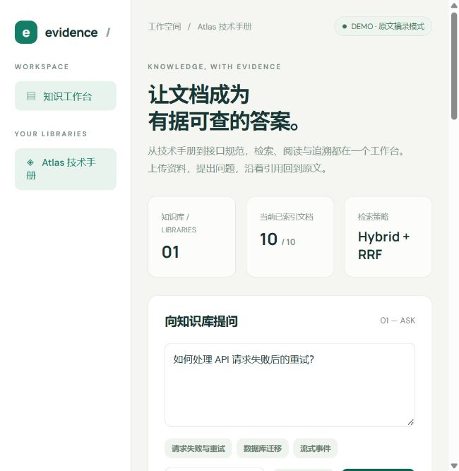
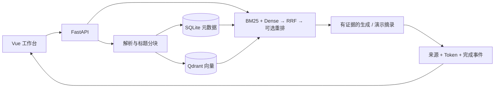

# Evidence RAG

**让技术文档成为有据可查的答案。** 一个面向本地单用户的知识库问答项目，展示文档解析、混合检索、引用溯源与可复现评测。

[CI 配置模板](ci/github-actions.yml) · 待 GitHub `workflow` 权限授权启用，远程 CI 尚未运行。
  



## 可以做什么

- 导入 Markdown、TXT、文本型 PDF，保留文档名称、标题、页码和段落位置。
- 对比向量召回、BM25 + 向量 RRF 融合、可选 API 重排，查看真实召回片段。
- 通过 SSE 接收回答，展开来源原文，检查引用编号是否越界。
- 检测重复文件、查看处理状态、重试失败文档、同步删除向量与元数据。
- 使用 10 份原创技术手册和 60 条标注问题运行检索消融实验。

默认是**显式演示模式**：哈希词袋向量 + 原文摘录，无需 API 密钥。它不是语义 Embedding，也不是 LLM 回答，不能作为真实模型准确率。设置 `DEMO_MODE=false` 后使用真实 API；错误会显式显示，不回退到演示数据。

## 本地启动

需要 Python 3.11+、Node.js 22+ 和 uv。以下命令在仓库根目录执行；首次运行需要下载依赖。

```bash
uv sync --frozen
```

复制 `.env.example` 为 `.env`（PowerShell：`Copy-Item .env.example .env`；其他 shell：`cp .env.example .env`）。保留 `DEMO_MODE=true` 可以立即演示。

```bash
npm --prefix web ci
npm --prefix web run build
uv run uvicorn app.main:app --host 127.0.0.1 --port 8000
```

打开 **http://127.0.0.1:8000**，创建知识库并上传 `examples/docs` 中的文件。也可在第二个终端执行 `uv run python scripts/seed.py` 导入示例手册。

开发前端：`npm --prefix web run dev`，Vite 将 `/api` 转发给 8000 端口。API 文档位于 `/docs`。

## Docker Compose

```bash
docker compose up --build
```

访问相同的 8000 端口。Compose 使用独立 Qdrant 服务，默认不向主机暴露 Qdrant 端口；本地直接运行采用 Qdrant local mode。元数据和向量分别持久化。

## 接入真实模型

编辑本地 `.env`，设置 `DEMO_MODE=false`、`LLM_BASE_URL`、`LLM_MODEL`、`LLM_API_KEY` 以及独立的 `EMBEDDING_*`。兼容 `/chat/completions` 的 SSE 输出和 `/embeddings` 协议。重排可选，要求接口返回 `results: [{index, relevance_score}]`。

切换演示/真实 Embedding 或变更模型时，使用新的 `DATA_DIR` 并重新导入文档，避免混用不同向量空间。使用远程 Qdrant 时还应使用新的服务/集合数据。不要把密钥写入前端或提交到 Git。

## 验证与评测

```bash
uv run ruff check .
uv run pytest -q
npm --prefix web test
npm --prefix web run build
uv run python -m evals.run
```

最后一个命令输出 `artifacts/retrieval.json`，明确标为 `demo_hash_embeddings`。它验证检索与报告管线。真实 Embedding 对比需配置密钥后显式运行 `uv run python -m evals.run --live`；配置重排后可添加 `--rerank`。真实调用可能产生费用，首次建议检查配置与服务商预算。

## 设计与边界



本项目不是生产级多租户平台：无账户鉴权；仅监听本机；单进程运行。暂不支持扫描 PDF OCR、网页抓取和 Word。RRF 得分不是置信度；引用编号有效也不代表语义受证据支持。无答案拒答和真实答案质量仍需人工审核与 live 评测。不要将演示模式的词袋效果包装成语义检索效果。

[架构与 API](docs/ARCHITECTURE.md) · [评测方法](docs/EVALUATION.md) · [三分钟演示](docs/DEMO.md) · [面试讲解](docs/INTERVIEW.md) · [简历描述](docs/RESUME.md)

MIT 开源；示例文档为原创虚构规范，非第三方生产文档。
